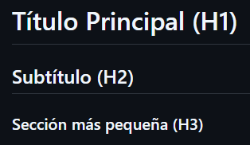
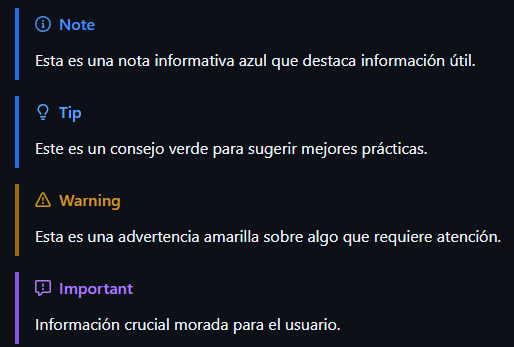

# ¿Como escribir un README?

## Teoria

El archivo README es la carta de presentacion oficial de cualquier repositorio en GITHUB.
Es el primer archivo que ven otros desarrolladores o usuarios al entrar al proyecto, funcionando como un manual de instrucciones.

Su importancia radica en que rara vez es utilizado un codigo si no tiene una buena documentacion. El README explica sobre que trata tu software, como instalarlo y ejecutarlo.

La extension `.md` significa **MARKDOWN** el cual es un lenguaje de marcado que permite dar formato visual al texto con el uso de simbolos simples como asteriscos o numerales. 

## Sintaxis

### Titulos y encabezados

Utiliza el símbolo de numeral `#` seguido de un espacio. La cantidad de numerales define el tamaño del título (del 1 al 6).

\# Título Principal (H1) <br>
\## Subtítulo (H2) <br>
\### Sección más pequeña (H3) <br>



### Enfasis en el texto (Parrafos)

Los párrafos se crean simplemente escribiendo texto de corrido y dejando una línea en blanco para separar uno de otro. Para resaltar palabras, usas asteriscos o guiones bajos.

| Sintaxis | Resultado |
|---|---|
| Texto normal | Texto normal |
| \*\*Negrita\*\* | **Negrita** |
| \*Cursiva\* | *Cursiva* |

### GitHub Alerts (Tooltips, Notas)

Esas cajas de colores con iconos que ves en GitHub para dejar notas, advertencias o tips se llaman Alertas. Se crean usando el símbolo de cita `>` seguido de una etiqueta específica entre corchetes.

\> [!NOTE]
\> Esta es una nota informativa azul que destaca información útil.

\> [!TIP]
\> Este es un consejo verde para sugerir mejores prácticas.

\> [!WARNING]
\> Esta es una advertencia amarilla sobre algo que requiere atención.

\> [!IMPORTANT]
\> Información crucial morada para el usuario.



### Bloques de codigo y comandos

Para mostrar comandos de terminal o fragmentos de código, se usan los acentos graves `` ` `` (backticks).

**Para un comando en la misma línea:**

| Comando | Resultado |
|---|---|
| \`npm install\` | `npm install` |


**Para crear bloques de código de varias líneas:**

Debes usar tres acentos graves ` ``` ` al principio y al final del bloque. Si quieres que GitHub le aplique colores (resaltado de sintaxis), solo añade el nombre del lenguaje (javascript, python, csharp, sql, etc.) justo después de los primeros tres acentos graves.

**Sintaxis**

````markdown
```javascript
function saludar() {
  console.log("¡Hola mundo!");
}
```
````

**Resultado**

```javascript
function saludar() {
  console.log("¡Hola mundo!");
}
```

### Listas Ordenadas/Desordenadas

Puedes crear listas ordenadas (con números) y desordenadas (con viñetas).

| Sintaxis | Resultado |
| :--- | :--- |
| \*\*Lista de tareas:\*\* <br> \- Configurar base de datos <br> \- Crear la API REST <br> \- Diseñar el frontend | **Lista de tareas:** <br> - Configurar base de datos <br> - Crear la API REST <br> - Diseñar el frontend |
| \*\*Pasos de instalación:\*\* <br> \1. Clonar el repositorio. <br> \2. Abrir la terminal. <br> \3. Ejecutar el script. | **Pasos de instalación:** <br> 1. Clonar el repositorio. <br> 2. Abrir la terminal. <br> 3. Ejecutar el script. |


### Enlaces e imagenes

La sintaxis es casi idéntica, pero las imágenes llevan un signo de exclamación `!` al principio.

\[Link de ejemplo](https://example.com)

[Link de ejemplo](https://example.com)

\!\[Texto alternativo de la imagen](url-de-la-imagen)


### Scape

Para que Markdown ignore un símbolo de formato y lo muestre de forma literal, debes colocar una barra invertida `\` justo antes del carácter.

**Ejemplo:** 

`\#titulo`

Para "escapar" un bloque entero de texto y que todo se muestre de forma literal sin tener que poner una barra invertida (\) línea por línea, debes usar los bloques de código (los tres acentos graves **```**).

Todo lo que coloques dentro de estos acentos se renderizará exactamente como lo escribiste, ignorando cualquier símbolo de Markdown. Es recomendable poner text al lado de los acentos de apertura para decirle a GitHub que es texto plano y no intente colorearlo.

````
```text
# Este título no se hará grande
**Este texto no estará en negrita**
- Esto no será una viñeta formateada
```
````
> [!NOTE]
> La regla de oro en Markdown es que el contenedor exterior siempre debe tener al menos un acento grave más que el texto que intentas mostrar adentro.


### Tablas

Para crear una tabla en Markdown, utilizas barras verticales (|) para separar las columnas y guiones (-) para separar la fila del encabezado del resto de los datos.

**Sintaxis**

``` text
| Encabezado 1 | Encabezado 2 |
|---|---|
| Texto 1 | Texto 2 |
```

**Resultado**

| Encabezado 1 | Encabezado 2 |
|---|---|
| Texto 1 | Texto 2 |
